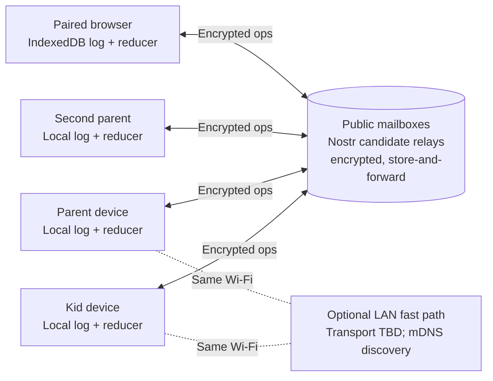

# Server-free PayDirt spike

**TL;DR:** Evaluate turning PayDirt into a public app that any household can install and run with no backend for the developer to operate or the household to set up. Screen an occurrence-keyed operation log and encrypted store-and-forward mailboxes (Nostr first), with direct LAN as an optional fast path. Policy validity, child privacy, sustainable relay use, and public-app Family Link scope remain open.

**Status:** Draft

**Last updated:** 2026-11-09

**Scope:** Policy modelling, dependency screening, and isolated experiments with fake household data. Production implementation and migration are not approved.

**Fold into:** [AGENTS.md](../../AGENTS.md) (project identity), [Deployment](../DEPLOYMENT.md), [data model](../DATA_MODEL.md), [device testing](../DEVICE_TESTING.md), and [features](../../FEATURES.md) if an architecture is approved.

**Related:** [Roadmap](../../ROADMAP.md), [feasibility evidence](../research/server-free-feasibility.md), [feature inventory](../../FEATURES.md).

## Contents

- [Goal and product shift](#goal-and-product-shift)
- [Current state](#current-state)
- [Constraints and decisions](#constraints-and-decisions)
- [Proposed architecture](#proposed-architecture)
- [Conflict policy proposals](#conflict-policy-proposals)
- [Transport shortlist](#transport-shortlist)
- [Privacy assessment](#privacy-assessment)
- [Phases and verification gates](#phases-and-verification-gates)
- [Cost and adoption assessment](#cost-and-adoption-assessment)
- [Risks and failure policies](#risks-and-failure-policies)
- [Rollback and production boundaries](#rollback-and-production-boundaries)
- [Open decisions](#open-decisions)
- [Iteration and exit report](#iteration-and-exit-report)

## Goal and product shift

- **Target:** a public app that any household can install. The current one-household showcase on bb is the reference implementation, not the destination.
- **Identity change:** AGENTS.md currently says "built for one household, not a hosted service". If a production product shift is approved, update that text, FEATURES.md, and the roadmap together; approval to experiment alone does not change the current product identity.
- **Family Link:** the unofficial API driven by a copied Google session does not scale. Its risks are Terms of Service exposure, silent breakage, and a Google session on every parent phone. Dropping automated grants, limiting them to an advanced mode, and keeping manual parent grants as the baseline are proposals requiring owner acceptance. Existing household automation remains unchanged during research. An unsupported toggle does not lower the correctness requirements for any enabled external grants.
- **No bill that grows with adoption:** mass adoption must not create a developer-funded service. Public infrastructure is acceptable only if its cost does not land on the developer and the app keeps working usefully when that infrastructure is unavailable.
- **Not a hidden server:** a parent phone may hold specific roles, such as being the export source. It must never be a required always-on household server.

## Current state

- **Production:** PocketBase on bb with an append-only `currency_transactions` ledger. [`verifyLedger`](../../packages/shared/src/ledger.ts) already derives balances by folding that ledger, and the proposed data model reuses this idea.
- **Model spike:** four [signed-operation tests](../../packages/shared/src/serverFree.spike.test.ts) and a three-browser WebRTC experiment. They prove offline recording, catch-up, and duplicate-safe settlement with a designated settlement authority and a fixed reward. Not covered: physical devices, cross-network delivery, pairing, recovery. See the [gap matrix](../research/server-free-feasibility.md#parity-and-gap-matrix).
- **Gate 0 (Iroh screen), done 2026-11-08:** conditional go for a LAN harness only. An untested Kotlin-version difference, a relay-only browser path, and hosted-relay economics prevent selecting it as the primary transport. The version difference is a build risk, not an observed compile failure. See the [screen](../research/server-free-feasibility.md#2026-11-08--iroh-dependency-and-cost-screen).
- **Existing public dependencies:** ntfy.sh (push notifications) and bb (APK updates, nightly backups). A server-free design has to replace or explicitly keep each one.

## Constraints and decisions

| State | Requirement or decision | Consequence |
|---|---|---|
| Confirmed | Public app for any household | Pairing, onboarding, and recovery must work without technical setup. |
| Confirmed | No developer-operated or household-provisioned backend | Inventory every relay, mailbox, update, and backup dependency. |
| Confirmed | No developer bill that grows with adoption | Free tiers or volunteer services do not count as unlimited production capacity. |
| Confirmed | No Play Services in PayDirt's code | Rules out any transport or wake mechanism that needs FCM. |
| Confirmed | Full parent/kid parity, useful offline behaviour, web access desired | Reduced functionality is listed as a gap, never hidden. |
| Open | Public-app Family Link scope | Removing automation or changing its availability requires owner acceptance. External-effect recovery remains P0 whenever automation is enabled. |
| Proposed | Occurrence-keyed log + deterministic reducer; evaluate removing the settlement authority | Same-log convergence and valid/stable business outcomes are separate gates. See [Conflict policy proposals](#conflict-policy-proposals). |
| Proposed | Store-and-forward mailbox is the primary transport | Asynchronous delivery can work without simultaneous peer reachability; Android background availability must be measured. |
| Proposed | Nostr screened first; ntfy as fallback; Iroh/LAN as an optional accelerator | Potential shared JS transport; Hermes/crypto/storage compatibility, retention and sustainable funding still require proof. |
| Open | Which privacy trade-offs on public relays are acceptable | See [Privacy assessment](#privacy-assessment). |

## Proposed architecture

- **Data model:** each device keeps an append-only log of signed operations, each with a globally unique ID. Reward credits use a canonical **occurrence ID** based on parent-authorized chore/schedule version, household-calendar occurrence and child. A race additionally needs a shared race-group ID across children. Validate reward snapshots and prerequisites. Evaluate balances as a projection of accepted operations; the existing ledger fold is a reference, not proof of distributed authorization.
- **Merge:** operations are a grow-only set. Merging is a set union, so it is idempotent and order-independent. The reducer must converge for the same operation set and separately enforce [business and security policies](#conflict-policy-proposals). A device missing operations can show a provisional state that changes on catch-up; deterministic merge alone does not establish stable payouts or authorized actions.
- **Ordering:** evaluate HLC for display and stable tie ordering only. It does not prove physical time, who completed a race first, or authorization. Use explicit causal references for superseding decisions; adversarial clocks must not create extra occurrences, authority, or rewards.
- **Transport:** evaluate per-recipient encrypted operation delivery through mailbox routing keys that do not decrypt data. Specify acknowledgments, expiry, bounded retries/backoff, catch-up after relay loss, and retirement of lost peers; do not re-publish indefinitely waiting for every device. A peer can export only records the recipient is authorized to receive. The LAN path is an optimisation, not a requirement.
- **Validation:** verify canonical operation signatures, parent-authorized reward/schedule snapshots, roles and causal prerequisites before granting credit. Deduplicate by inner operation ID across different encrypted envelopes; quarantine ID/content collisions and malformed operations. Receiving a valid gift wrap does not itself authorize a business action.
- **Shared code:** keep the candidate reducer and transport harness isolated from production exports. If selected later, reuse shared logic across web/mobile and run the same invariants on both. Do not replicate live SQLite files.
- **Not a blockchain.** No requirement calls for global consensus or a public ledger.

The pending [chore conversation and earned-time bank features](../../ROADMAP.md#backlog-unscheduled) add lifecycle requirements to the eventual parity assessment: role-scoped threaded history, held versus queued minutes, and concurrent time redemption. They are roadmap scope, not implemented features.

## Conflict policy proposals

These are unresolved product/security policies to model in Phase 1. Deriving balances does not eliminate authorization, revocation, or consistency risks. Accepting temporary negative balances or changing race outcomes is an explicit product trade-off, not an automatic consequence of convergence.

| Case | Policy to model | Required invariant / open decision |
|---|---|---|
| Two parents approve one occurrence | At most one effective credit using canonical occurrence identity | Different reward snapshots, partial credit, duplicate IDs and malformed approvals cannot mint extra credit. |
| Concurrent approval and rejection | Propose reject for truly concurrent decisions; a later re-approval explicitly references/supersedes the rejection | Owner must accept the rule; replay/reordering must not change its result. Do not rely on wall-clock latest-wins. |
| Offline spending exceeds balance | Compare provisional spending/reservations against allowing a temporary negative balance | Negative balance policy is not accepted. Define when a request becomes final and block or flag new spending as agreed. |
| Multiple offline race claims | Compare provisional winner pending parent resolution, or explicitly accepted pay-both policy | HLC cannot prove the first real-world finisher. Define a shared race-group identity and what happens to already-spent rewards. |
| Reversal / undo | Compensating operation references an effective credit/decision | Duplicate or concurrent reversals cannot debit twice; compensation cannot exceed the referenced effective credit. |
| Revocation and delayed old-epoch operations | Signed membership changes and causal cutoffs; quarantine ambiguous late operations for parent recovery/decision | A revoked device can label new work with an old epoch or time. Epoch labels alone are insufficient; no revoked peer regains authority by replay. |
| Schema/version skew | Store unknown operations opaquely; quarantine their dependent projections/actions | An older client must not show a final spendable balance or accept dependent decisions using incomplete semantics. |
| External effects, if enabled | One explicit executor plus dedupe keys and reconciliation | Single-executor design alone cannot resolve a crash after Google acts but before local acknowledgment. Keep this P0. |

## Transport shortlist

| Candidate | Role | Strengths | Gaps / risks |
|---|---|---|---|
| **Nostr relays — first screen** | Primary mailbox | Store-and-forward candidate; WebSocket availability and relay suitability must be verified in browsers and React Native; JS library ([nostr-tools](https://github.com/nbd-wtf/nostr-tools)); NIP-44 encryption, NIP-59 gift wrap | Retention not guaranteed; relay policies vary (rate limits, kind filters, auth); metadata exposure (see privacy) |
| **ntfy — fallback** | Mailbox and push | Already in the stack; no Play Services; SSE/WebSocket; self-hostable | Single operator per server; ntfy.sh caches about 12 h; not intended as a data bus at scale; paid tiers |
| **Iroh — optional LAN accelerator** | Direct device-to-device on same Wi-Fi | Fast and private on LAN; [Gate 0](../research/server-free-feasibility.md#2026-11-08--iroh-dependency-and-cost-screen) done | Both peers must be online; Kotlin 2.2 vs 2.1 compatibility untested; native bridge; relay-only browser |
| **Syncthing** | Comparison only | Mature discovery/relay | File conflicts, not transactions; embedding/UX; both peers online |
| **Briar / Bramble** | Bluetooth/Tor reference | Proven Android radios | Library boundaries, GPL, no browser |
| **libp2p** | Broad fallback | Many transports | Most integration work; relays still cost someone |
| **Automerge** | Likely unnecessary | General CRDT merge | Custom log/reducer may suffice, but must pass authorization, lifecycle and convergence gates before dismissing a library |

Notifications: a Nostr subscription can also drive in-app alerts while the app is running. Background push without FCM still needs ntfy (or UnifiedPush). Keep ntfy for wake-ups and send no sensitive content through it.

## Privacy assessment

Kids' data travelling over public relays is the main new risk. Encryption protects **content**. It does not protect **metadata**, and nothing guarantees deletion.

### What a relay operator can see

| Exposure | Plain NIP-44 | With NIP-59 gift wrap |
|---|---|---|
| Message content | Hidden | Hidden |
| Sender key | Visible | Hidden (ephemeral outer key) |
| Recipient key (`p` tag) | Visible | Visible, but can be a rotating mailbox key |
| Timestamp | Real | Randomized on the outer event |
| Size, frequency, timing patterns | Visible | Visible unless padded/batched |
| Client IP address | Visible | Visible (Tor/Orbot optional) |

### Implications

- **Household clustering:** a relay can link a household's devices by shared mailbox keys and IP addresses. Activity timing can reveal routines, such as when kids are home or using devices.
- **Permanence:** relays may keep events forever and mirror them to archives. NIP-09 deletion and NIP-40 expiry are advisory. Assume ciphertext is public forever.
- **No forward secrecy:** NIP-44 uses static-key ECDH. A device key compromised later can decrypt archived history encrypted to that key. This is the "harvest now, decrypt later" risk.
- **Developer choice of default relays:** choosing defaults decides where children's encrypted data goes. App-store listings require a privacy policy even when the developer runs no servers. Do not infer reduced children's-privacy obligations from the absence of a developer-operated server; third-party processing, defaults and distribution need a separate review before release.
- **Photos:** propose keeping them off public relays until a separate encrypted attachment/storage design is assessed. LAN-only delivery or dropping photos reduces parity and requires explicit owner acceptance; neither is a confirmed product change.

### Mitigations to test in Phase 2

- **Gift wrap candidate operations:** assess NIP-59 metadata protection and remaining leaks. Keep independently signed canonical PayDirt operations inside the encrypted payload and validate them after decryption; NIP-59 rumors are unsigned, so envelope validity alone must not establish durable business authorization ([specification](https://github.com/nostr-protocol/nips/blob/master/59.md)).
- **Routing versus decryption keys:** separate mailbox routing identities from device signing keys and per-recipient/per-child content keys. A common household key must not let siblings decrypt each other's private records. Evaluate routing-key rotation without claiming it prevents IP/timing correlation.
- **Key lifecycle:** rotation alone is not forward secrecy. Deriving all epochs from one retained secret exposes derived epochs if that secret leaks; wrapping old epoch keys to a compromised long-lived key may expose history too. Specify key distribution, recovery, erasure and offline catch-up. Use an established reviewed protocol if forward secrecy is required; do not invent one in the spike. NIP-44 explicitly lacks forward and post-compromise secrecy ([limitations](https://github.com/nostr-protocol/nips/blob/master/44.md#limitations)).
- **Traffic shaping:** pad to fixed size buckets and batch operations to blunt size and timing analysis.
- **Minimal payloads:** IDs, amounts, and status only. Chore titles, notes, and kid names travel encrypted but should be avoidable via local catalogue references where practical.
- **Relay hygiene:** default to relays with published retention/expiry policies and support for authentication (NIP-42). Let households choose or add relays, including a paid relay they fund themselves.
- **Comparison:** document precisely what ntfy and Iroh operators can observe, retain or log. An encrypted ntfy payload differs from the current plaintext notification path; a stream relay is not a durable mailbox, but that does not guarantee no operator logging. Record evidence and unknowns per candidate.

**Gate input:** a written threat model and data-exposure table per transport, reviewed before any default relay list ships.

### Connection settings: default vs bring-your-own

A setup wizard offers two paths:

- **Candidate default:** public relays plus ntfy.sh, subject to sustainability, privacy and reliability gates. No default list or production recommendation is selected yet.
- **Advanced:** the household's own Nostr relay URL(s) and/or ntfy server. Optionally keep public relays as a fallback, with the privacy trade-off shown in the wizard.

**Boundary:** only endpoints are pluggable. The data model, reducer, and app are identical in both modes. "Own instance" means off-the-shelf relay software (for example strfry or nostr-rs-relay) or an existing ntfy server. There is no self-hosted PocketBase mode, because a second backend architecture would double the test matrix.

**Rules:**

- **Privacy option:** evaluate a household-controlled relay with authenticated read/write ACLs. NIP-42 authentication alone is not authorization; verify actual access restrictions, hosting/logging exposure, and any public fallback. Own-relay-only must remain possible without silently sending data to public services.
- **Validated before saving:** the wizard publishes and reads back a test event, checks observed read/write authorization and size limits, and distinguishes documented retention from observed event availability. A short probe cannot promise future retention. It refuses a configuration that fails the tested requirements.
- **Household-wide:** the relay list is a signed, parent-only configuration operation in the log. Online authorized devices can apply it; offline devices need a recovery/catch-up route. Kid devices cannot authorize endpoint changes.
- **Pairing:** QR pairing carries the current relay list, so new devices join the right relays.
- **Migration overlap:** during a relay change, use bounded overlap plus an explicit membership/recovery policy. A lost device must not force indefinite publishing, and an offline device must have a way to discover changed endpoints without relying forever on a dead old relay. Public fallback requires an explicit household choice.
- **Optional:** bring-your-own is never required. The default path must meet every gate on its own.

## Phases and verification gates

Time boxes are initial estimates. Exceeding one triggers reassessment, not automatic expansion. Start Phase 0b as a passive desk screen alongside a minimal Phase 1 policy model. Complete the policy/security gate before live mailbox payload design. Pause Iroh harness work until the mailbox approach has been screened.

### 0. Iroh dependency and cost screen — done 2026-11-08

Conditional go for a LAN harness only. See [Current state](#current-state).

### 0b. Viability and Nostr screen

**Estimate:** half a day.

- Confirm the Family Link scope for the public app: removed, or locked-down advanced mode.
- Screen Nostr: current NIP-44/NIP-59 status and audits, nostr-tools React Native compatibility, published relay policies/metadata (accepted kinds, size limits, rate limits, retention, read/write auth), and usage terms. Avoid a large active survey until a minimal mailbox experiment succeeds.
- Screen ntfy as the fallback: ntfy.sh limits, cache duration, and terms for data-bus use.
- List the replacements needed for bb's update and backup roles (see Phase 5).

**Gate:** desk-based go/no-go per candidate, a source-backed policy table, and explicit unknowns. No free-capacity guarantee is inferred. Pick only a small eligible relay sample for Phase 2; expand to 10+ only if useful evidence justifies it.

### 1. Policy and reducer model

**Estimate:** one to two days. No devices.

- Extend [`serverFree.spike.test.ts`](../../packages/shared/src/serverFree.spike.test.ts): preserve the designated-authority experiment as a baseline and add a separate authority-free candidate using occurrence-keyed operations. Do not replace existing evidence with an unproven model.
- Add property tests for random merge orders, duplicates, missing predecessors, malicious clocks, forged role/epoch claims, conflicting reward snapshots, and repeated/concurrent compensation. Assert both convergence and valid business/security outcomes. Explicitly test provisional state becoming final or being revised on catch-up.
- Cover every row in [Conflict policy proposals](#conflict-policy-proposals), plus reversals, recurrence/timezone occurrence IDs, membership epochs, and schema-version skew.
- Assert that a balance is always `fold(log)`, reusing the `verifyLedger` approach.

**Gate:** convergence and authorization/accounting invariants pass separately, and the owner accepts the product conflict policies. A negative-balance policy or authority removal is not approved by a deterministic test alone.

### 2. Mailbox transport (browser and Node)

**Estimate:** one to two days for initial connectivity evidence. Long retention observations run separately; no devices are needed for the initial browser/Node experiment.

- Begin with one encrypted, independently signed fake operation through a small, policy-eligible relay sample, using isolated headless Playwright contexts and a Node client. Verify round-trip, offline catch-up, rejection handling and observed metadata. Bound payloads, retries and traffic; use no household identifiers or real child data. Expand protocol/key-rotation cases only after the minimal path works.
- One peer stays offline for hours. Confirm catch-up from relay storage alone, then with relays dropping events (re-publishing and peer-served catch-up).
- Measure bytes per operation, delivery latency and rejection rate. Schedule 24 h, 7 d and 30 d retention observations separately, recording start/due dates and service changes. Early success cannot close the long-term reliability gate.
- Fill in the privacy exposure table from real observation.

**Initial gate:** publish/read, offline catch-up and rejection recovery pass with fake operations; measured cost/privacy inputs and compatibility evidence are recorded. **Later durability gate:** complete the scheduled retention and total-mailbox-loss tests before recommending defaults. Relay disappearance with all peers offline remains a recovery case, not solved by replication count alone.

### 3. Android devices and background behaviour

**Estimate:** one to two days. Needs two physical devices, ideally one Google-free. An emulator-only result does not pass.

- Verify the same transport in an Expo development build, including Hermes crypto, secure randomness, WebSocket reconnection and durable key/storage adapters. A JS package alone does not prove a bridge-free mobile integration.
- Measure foreground, background, screen-off, battery-restricted, network change, and restart behaviour under Doze without FCM.
- Test the ntfy/UnifiedPush wake-up followed by a Nostr fetch.
- Optional: Iroh LAN fast path in a disposable harness, only if mailbox latency on the same Wi-Fi is unacceptable.

**Gate:** documented delivery expectations per device state, with no promise of instant delivery while devices sleep.

### 4. Identity, pairing, and recovery

**Estimate:** two days.

- Household creation, QR pairing for kids and a second parent, role-scoped keys, and revocation with epoch rotation.
- Device loss: recover from any remaining parent device. All devices lost: encrypted export plus a recovery phrase/file.
- Private kid data: per-child scoping so a sibling device cannot decrypt another child's operations.
- Connection wizard: default path, plus switching to an own relay with validation, propagation to all devices, overlap, and recovery from a bad relay URL.
- Run a non-technical onboarding walkthrough with a household that is not the developer's.

**Gate:** no unauthorized operation is accepted, no sibling data exposure, and a tested recovery path that someone other than the developer can complete.

### 5. Distribution, updates, backups, notifications

**Estimate:** one day of assessment.

- **Updates:** replace bb's in-app updater with F-Droid (own repo or main), Obtainium/GitHub Releases, and optionally Play Store. Note GitHub Releases is free but is still a third-party dependency.
- **Backups:** encrypted export to user-chosen storage (file share, local file, any WebDAV). The developer stores nothing.
- **Notifications:** ntfy topic defaults, a self-host option, and how push degrades when ntfy is unavailable.
- **Web:** compare a static frontend on free static hosting (the app shell only, no data) with local-only use. Check secure-context, storage-eviction, and recovery constraints in the [web path table](../research/server-free-feasibility.md#transport-and-browser-assessment).

**Gate:** every former bb role has a named replacement, cost owner, and failure mode.

### 6. Parity and exit

- Update the [parity matrix](../research/server-free-feasibility.md#parity-and-gap-matrix) for spending, banked time, races, reversals, recurrence/timezones, timers, photos, notes/templates, Kudos/goals, reports, archives/help, membership, notifications, backups, and updates.
- Produce the [exit report](#iteration-and-exit-report).

## Cost and adoption assessment

Model **100,000 and 1,000,000 households**, separating households, registered devices, active devices, and operations per day. Include a pessimistic case.

- **Developer bill:** target $0 per household at both levels. A domain may be fixed cost, but static app delivery and package repositories can incur adoption-dependent bandwidth/storage. Identify their cost owners and quotas; do not classify them as fixed merely because a free hosting tier exists.
- **Public relay load:** `monthly relay bytes = active households × ops per month × padded op size × relays published to × re-publish factor`. Report the load per relay as well as the total. Relay operators will reject or rate-limit unwelcome volume.
- **Who pays:** public relays are funded by their operators. Record whether household usage at scale would be unwelcome, and test a "household-funded paid relay" option.
- **Photos and backups:** excluded from relays by design. Note their own storage owner.
- **Fallback:** the app must keep working locally, and over LAN or manual export, if every default relay disappears.

**Gate:** explicit cost owner and assumptions per dependency at both adoption levels. Do not justify a mandatory developer service by claiming household messages are tiny.

## Risks and failure policies

| Priority | Risk | Required response |
|---|---|---|
| P0 | Children's data or behaviour patterns exposed via relays | Threat model, gift wrap, rotating keys, padding, minimal payloads, no photos on relays, privacy policy. |
| P0 | Reducer diverges across devices | Property-based convergence tests; schema-versioned operations; identical reducer code on every platform. |
| P0 | Unauthorized device writes or reads a sibling's data | Role-scoped keys, per-child encryption, epoch revocation, tested pairing. |
| P0 | All household devices lost | Recovery phrase/file plus encrypted export; tested by a non-developer. |
| P1 | Relays drop events, rate-limit, or ban the event kind | Multiple relays, re-publish until acknowledged, peer-served catch-up, user-selectable relays. |
| P1 | Devices asleep, so changes arrive late | Truthful "pending sync" state; ntfy/UnifiedPush wake-ups; no instant-delivery promise. |
| P1 | Conflict rules surprise parents (negative balance, reversed race win) | Visible "changed by" history; owner-accepted policy table; reversible actions. |
| P0 | Clock/epoch manipulation or missing membership history creates unauthorized work | Canonical parent-authorized occurrence identity, causal validation and explicit revocation policy; HLC is not trusted time. |
| P1 | Update/distribution channel unavailable | At least two channels (F-Droid + GitHub Releases); old versions stay compatible with stored data. |
| P0 if enabled | Family Link executor double-grants after a crash | Explicit executor plus dedupe and external reconciliation; advanced/unsupported status does not lower correctness requirements. |
| P2 | Optional LAN accelerator costs more than it saves | Build it only if Phase 3 latency demands it. |

## Rollback and production boundaries

- The spike uses separate fixtures, test identities, fake rewards, and throwaway relay keys. Remove the harness and dependencies if rejected; no production rollback is needed.
- The bb deployment for this household stays unchanged throughout. Family Link automation stays private to it.
- **Before any cutover:** validated signed export from PocketBase into the operation log, `verifyLedger` totals matching on both sides, a cutover freeze, and a single Family Link executor. Never run PocketBase and peer grant paths at the same time. Rollback must reconcile operations and irreversible grants since cutover; restoring the old database alone is not enough.
- Production changes need explicit approval.

## Open decisions

- **Privacy:** which metadata exposure is acceptable for children's data on public relays? Is Tor/Orbot offered, defaulted, or skipped?
- **Default relays:** who picks them, and how often is the list reviewed?
- **Bring-your-own mode:** may it keep public relays as a fallback, or must it be own-relay-only?
- **Conflict policies:** approve vs reject winner, negative balances, race tie-break (see the policy table).
- **Recovery:** recovery phrase, file export, or both?
- **Family Link:** retain, remove, or restrict automation in the public app? No change is confirmed. Any reduction in parity requires explicit owner acceptance.
- **Browser:** full parity at launch, or after native parity?
- **Phase 3 devices:** which physical devices and independent networks are available?

Resolve each decision before the phase that depends on it. Do not let missing answers silently become architecture.

## Iteration and exit report

- Append observations to the [research evidence](../research/server-free-feasibility.md): date, candidate/version, environment, relays used, measured results, failures, and artifacts per gate.
- The exit report contains: a go/no-go recommendation, the parity/gap matrix, the cost-owner table, the privacy threat model, the accepted conflict policies, and migration/rollback implications.
- A failed candidate is a useful outcome. Do not replace a failed gate with unlimited custom implementation.
- After approved work ships, fold stable content into the official docs, record the decision in the ledger, and archive this plan with a status stamp.
