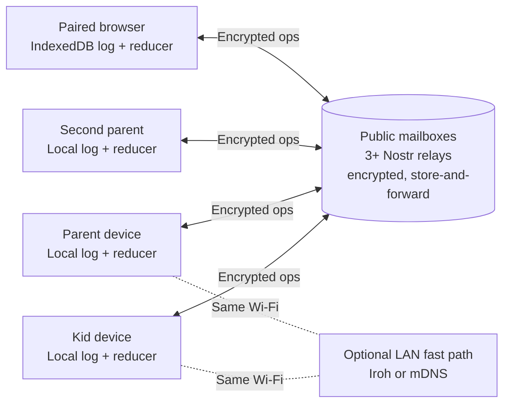

# Server-free PayDirt spike

**TL;DR:** Evaluate turning PayDirt into a public app that any household can install and run with no backend for the developer to operate or the household to set up. Balances come from an occurrence-keyed operation log that merges deterministically. Encrypted operations travel through public store-and-forward mailboxes (Nostr first), with direct LAN as an optional fast path. Family Link is removed or locked down for the public app.

**Status:** Draft

**Last updated:** 2026-11-09

**Scope:** Policy modelling, dependency screening, and isolated experiments with fake household data. Production implementation and migration are not approved.

**Fold into:** [AGENTS.md](../../AGENTS.md) (project identity), [Deployment](../DEPLOYMENT.md), [data model](../DATA_MODEL.md), [device testing](../DEVICE_TESTING.md), and [features](../../FEATURES.md) if an architecture is approved.

**Related:** [Roadmap](../../ROADMAP.md), [feasibility evidence](../research/server-free-feasibility.md), [feature inventory](../../FEATURES.md).

## Contents

- [Goal and product shift](#goal-and-product-shift)
- [Current state](#current-state)
- [Constraints and decisions](#constraints-and-decisions)
- [Proposed architecture](#proposed-architecture)
- [Conflict policy proposals](#conflict-policy-proposals)
- [Transport shortlist](#transport-shortlist)
- [Privacy assessment](#privacy-assessment)
- [Phases and verification gates](#phases-and-verification-gates)
- [Cost and adoption assessment](#cost-and-adoption-assessment)
- [Risks and failure policies](#risks-and-failure-policies)
- [Rollback and production boundaries](#rollback-and-production-boundaries)
- [Open decisions](#open-decisions)
- [Iteration and exit report](#iteration-and-exit-report)

## Goal and product shift

- **Target:** a public app that any household can install. The current one-household showcase on bb is the reference implementation, not the destination.
- **Identity change:** AGENTS.md currently says "built for one household, not a hosted service". If this spike is approved, update that text, FEATURES.md, and the roadmap in the same change.
- **Family Link:** the unofficial API driven by a copied Google session does not scale. Its risks are Terms of Service exposure, silent breakage, and a Google session on every parent phone. The public app drops automated grants, or keeps them locked behind an unsupported advanced toggle. Screen time stays a manual parent grant, which is how the app's model originally described it.
- **No bill that grows with adoption:** mass adoption must not create a developer-funded service. Public infrastructure is acceptable only if its cost does not land on the developer and the app keeps working usefully when that infrastructure is unavailable.
- **Not a hidden server:** a parent phone may hold specific roles, such as being the export source. It must never be a required always-on household server.

## Current state

- **Production:** PocketBase on bb with an append-only `currency_transactions` ledger. [`verifyLedger`](../../packages/shared/src/ledger.ts) already derives balances by folding that ledger, and the proposed data model reuses this idea.
- **Model spike:** four [signed-operation tests](../../packages/shared/src/serverFree.spike.test.ts) and a three-browser WebRTC experiment. They prove offline recording, catch-up, and duplicate-safe settlement with a designated settlement authority and a fixed reward. Not covered: physical devices, cross-network delivery, pairing, recovery. See the [gap matrix](../research/server-free-feasibility.md#parity-and-gap-matrix).
- **Gate 0 (Iroh screen), done 2026-11-08:** conditional go for a LAN harness only. A Kotlin version conflict, a relay-only browser path, and Pro relay pricing at scale block selecting it as the primary transport. See the [screen](../research/server-free-feasibility.md#2026-11-08--iroh-dependency-and-cost-screen).
- **Existing public dependencies:** ntfy.sh (push notifications) and bb (APK updates, nightly backups). A server-free design has to replace or explicitly keep each one.

## Constraints and decisions

| State | Requirement or decision | Consequence |
|---|---|---|
| Confirmed | Public app for any household | Pairing, onboarding, and recovery must work without technical setup. |
| Confirmed | No developer-operated or household-provisioned backend | Inventory every relay, mailbox, update, and backup dependency. |
| Confirmed | No developer bill that grows with adoption | Free tiers or volunteer services do not count as unlimited production capacity. |
| Confirmed | No Play Services in PayDirt's code | Rules out any transport or wake mechanism that needs FCM. |
| Confirmed | Full parent/kid parity, useful offline behaviour, web access desired | Reduced functionality is listed as a gap, never hidden. |
| Confirmed | Family Link removed or locked down in the public app | Grant-executor recovery is no longer a P0 blocker for the public app. |
| Proposed | Occurrence-keyed log + deterministic reducer, no settlement authority | See [Conflict policy proposals](#conflict-policy-proposals). Automerge is likely unnecessary. |
| Proposed | Store-and-forward mailbox is the primary transport | Peer-to-peer requires both devices to be awake at once; phones under Doze rarely are. |
| Proposed | Nostr screened first; ntfy as fallback; Iroh/LAN as an optional accelerator | Covers browser and native from one JS code path with no developer bill. |
| Open | Which privacy trade-offs on public relays are acceptable | See [Privacy assessment](#privacy-assessment). |

## Proposed architecture

- **Data model:** each device keeps an append-only log of signed operations, each with a globally unique ID. Rewards are keyed by **occurrence ID** (chore + household-calendar occurrence + child). The balance is `fold(merged log)`, never a replicated counter.
- **Merge:** operations are a grow-only set. Merging is a set union, so it is idempotent and order-independent. The reducer applies [conflict policies](#conflict-policy-proposals) deterministically, so every device that has the same set of operations shows the same state.
- **Ordering:** hybrid logical clocks (HLC) break ties and show recency. Device wall clocks are never trusted for authority.
- **Transport:** each device publishes encrypted operations to a household mailbox on several relays and keeps re-publishing until peers acknowledge receipt. Any device holding the log can serve catch-up. The LAN path is an optimisation, not a requirement.
- **Shared code:** the reducer lives in `packages/shared`, and the same tests run on web, mobile, and model. Do not replicate SQLite files.
- **Not a blockchain.** No requirement calls for global consensus or a public ledger.

## Conflict policy proposals

Most of the old "P0 consensus" risks become product rules once balance is derived rather than settled. These are proposals to model in Phase 1, not accepted policy.

| Case | Proposed rule | Why it is safe enough |
|---|---|---|
| Two parents approve the same occurrence | One credit by construction (occurrence-keyed) | Duplicate approvals merge into one. No authority needed. |
| One parent approves, another rejects | Reject wins (or latest decision by HLC — choose one), shown as "changed by Parent 2" | Deterministic and visible. A parent can re-approve. |
| Offline spending exceeds balance | Allow a temporary negative balance, flag it, block new spending until it is positive | Family virtual currency, not a bank. Parents resolve it. |
| Race chore claimed by two kids offline | Earliest approved claim by HLC wins; loser gets a visible reversal (alternative: pay both) | Deterministic, explainable, rare. |
| Approval reversal / undo | Compensating operation referencing the original | The log stays append-only, as the current ledger is. |
| Revoked device rejoins | Operations after its revocation epoch are rejected; earlier ones are kept | Needs membership operations in the same log. |
| Schema/version skew | Operations carry a schema version; unknown versions are stored but not reduced until the app updates | Older devices never corrupt state. |
| External effects (Family Link, if locked-down mode exists) | One explicit executor device with a per-grant dedupe key | The only place a single authority is still needed. |

## Transport shortlist

| Candidate | Role | Strengths | Gaps / risks |
|---|---|---|---|
| **Nostr relays — first screen** | Primary mailbox | Store-and-forward; hundreds of public relays; WebSocket works in browsers and React Native; pure JS ([nostr-tools](https://github.com/nbd-wtf/nostr-tools)); NIP-44 encryption, NIP-59 gift wrap | Retention not guaranteed; relay policies vary (rate limits, kind filters, auth); metadata exposure (see privacy) |
| **ntfy — fallback** | Mailbox and push | Already in the stack; no Play Services; SSE/WebSocket; self-hostable | Single operator per server; ntfy.sh caches about 12 h; not intended as a data bus at scale; paid tiers |
| **Iroh — optional LAN accelerator** | Direct device-to-device on same Wi-Fi | Fast and private on LAN; [Gate 0](../research/server-free-feasibility.md#2026-11-08--iroh-dependency-and-cost-screen) done | Both peers must be online; Kotlin 2.2 vs 2.1 conflict; native bridge; relay-only browser |
| **Syncthing** | Comparison only | Mature discovery/relay | File conflicts, not transactions; embedding/UX; both peers online |
| **Briar / Bramble** | Bluetooth/Tor reference | Proven Android radios | Library boundaries, GPL, no browser |
| **libp2p** | Broad fallback | Many transports | Most integration work; relays still cost someone |
| **Automerge** | Likely unnecessary | General CRDT merge | Grow-only signed log + reducer already covers the domain; second native dependency |

Notifications: a Nostr subscription can also drive in-app alerts while the app is running. Background push without FCM still needs ntfy (or UnifiedPush). Keep ntfy for wake-ups and send no sensitive content through it.

## Privacy assessment

Kids' data travelling over public relays is the main new risk. Encryption protects **content**. It does not protect **metadata**, and nothing guarantees deletion.

### What a relay operator can see

| Exposure | Plain NIP-44 | With NIP-59 gift wrap |
|---|---|---|
| Message content | Hidden | Hidden |
| Sender key | Visible | Hidden (ephemeral outer key) |
| Recipient key (`p` tag) | Visible | Visible, but can be a rotating mailbox key |
| Timestamp | Real | Randomized on the outer event |
| Size, frequency, timing patterns | Visible | Visible unless padded/batched |
| Client IP address | Visible | Visible (Tor/Orbot optional) |

### Implications

- **Household clustering:** a relay can link a household's devices by shared mailbox keys and IP addresses. Activity timing can reveal routines, such as when kids are home or using devices.
- **Permanence:** relays may keep events forever and mirror them to archives. NIP-09 deletion and NIP-40 expiry are advisory. Assume ciphertext is public forever.
- **No forward secrecy:** NIP-44 uses static-key ECDH. A device key compromised later can decrypt archived history encrypted to that key. This is the "harvest now, decrypt later" risk.
- **Developer choice of default relays:** choosing defaults decides where children's encrypted data goes. App-store listings require a privacy policy even when the developer runs no servers. Children's privacy rules (COPPA, GDPR-K) are lighter when the developer collects nothing, but this still needs review.
- **Photos:** never send them through public relays. Use LAN only, drop them, or design separately.

### Mitigations to test in Phase 2

- **Gift wrap everything:** publish through NIP-59 so sender and real timestamps are hidden.
- **Rotating mailbox keys:** derive the recipient mailbox key from the household secret and an epoch, and rotate on a schedule and on revocation. This limits clustering and caps how much history a compromised key exposes.
- **Epoch encryption keys:** encrypt payloads to a per-epoch household key rather than long-lived device keys. Rotating the epoch acts as coarse forward secrecy.
- **Traffic shaping:** pad to fixed size buckets and batch operations to blunt size and timing analysis.
- **Minimal payloads:** IDs, amounts, and status only. Chore titles, notes, and kid names travel encrypted but should be avoidable via local catalogue references where practical.
- **Relay hygiene:** default to relays with published retention/expiry policies and support for authentication (NIP-42). Let households choose or add relays, including a paid relay they fund themselves.
- **Comparison:** ntfy.sh is one operator that sees everything. Iroh relays see IPs and endpoint IDs but store nothing. Record the same exposure table for each candidate tested.

**Gate input:** a written threat model and data-exposure table per transport, reviewed before any default relay list ships.

### Connection settings: default vs bring-your-own

A setup wizard offers two paths:

- **Recommended (default):** public relays plus ntfy.sh. No setup, aimed at non-technical households.
- **Advanced:** the household's own Nostr relay URL(s) and/or ntfy server. Optionally keep public relays as a fallback, with the privacy trade-off shown in the wizard.

**Boundary:** only endpoints are pluggable. The data model, reducer, and app are identical in both modes. "Own instance" means off-the-shelf relay software (for example strfry or nostr-rs-relay) or an existing ntfy server. There is no self-hosted PocketBase mode, because a second backend architecture would double the test matrix.

**Rules:**

- **Privacy upgrade:** a household relay that only accepts the household's own keys (via NIP-42 auth) removes third-party metadata exposure. This is the recommended path for privacy-conscious households.
- **Validated before saving:** the wizard publishes and reads back a test event, checks auth and size limits, and reports observed retention. It refuses a configuration that fails.
- **Household-wide:** the relay list is a signed, parent-only configuration operation in the log. Every device switches, and kid devices cannot change it.
- **Pairing:** QR pairing carries the current relay list, so new devices join the right relays.
- **Migration overlap:** during a relay change, devices publish to both old and new relays until every member acknowledges. This prevents a lockout caused by a dead or mistyped relay.
- **Optional:** bring-your-own is never required. The default path must meet every gate on its own.

## Phases and verification gates

Time boxes are initial estimates. Exceeding one triggers reassessment, not automatic expansion. The cheap desk and model work comes first because its answers decide what the transport has to do.

### 0. Iroh dependency and cost screen — done 2026-11-08

Conditional go for a LAN harness only. See [Current state](#current-state).

### 0b. Viability and Nostr screen

**Estimate:** half a day.

- Confirm the Family Link scope for the public app: removed, or locked-down advanced mode.
- Screen Nostr: current NIP-44/NIP-59 status and audits, nostr-tools React Native compatibility, a sample of 10+ public relays (accepted kinds, size limits, rate limits, retention, auth), and terms.
- Screen ntfy as the fallback: ntfy.sh limits, cache duration, and terms for data-bus use.
- List the replacements needed for bb's update and backup roles (see Phase 5).

**Gate:** go/no-go per candidate, the relay sample table, and explicit unknowns.

### 1. Policy and reducer model

**Estimate:** one to two days. No devices.

- Extend [`serverFree.spike.test.ts`](../../packages/shared/src/serverFree.spike.test.ts): replace the designated settlement authority with occurrence-keyed operations and a deterministic reducer.
- Add property tests: random operation sets merged in random orders and duplicated must reduce to identical state.
- Cover every row in [Conflict policy proposals](#conflict-policy-proposals), plus reversals, recurrence/timezone occurrence IDs, membership epochs, and schema-version skew.
- Assert that a balance is always `fold(log)`, reusing the `verifyLedger` approach.

**Gate:** convergence tests pass, and the owner accepts or amends the policy table.

### 2. Mailbox transport (browser and Node)

**Estimate:** one to two days. No devices needed.

- Run the Phase 1 operations through real public Nostr relays from isolated Playwright contexts plus a Node client: gift-wrapped, padded, rotating mailbox key.
- One peer stays offline for hours. Confirm catch-up from relay storage alone, then with relays dropping events (re-publishing and peer-served catch-up).
- Measure bytes per operation, delivery latency, relay rejection rate, and retention observed after 24 h, 7 d, and 30 d.
- Fill in the privacy exposure table from real observation.

**Gate:** reproducible catch-up with one peer asleep, measured inputs for the cost and privacy tables, and no plaintext beyond the documented metadata.

### 3. Android devices and background behaviour

**Estimate:** one to two days. Needs two physical devices, ideally one Google-free. An emulator-only result does not pass.

- Same JS transport inside the Expo app on a dev build; no native bridge expected for Nostr.
- Measure foreground, background, screen-off, battery-restricted, network change, and restart behaviour under Doze without FCM.
- Test the ntfy/UnifiedPush wake-up followed by a Nostr fetch.
- Optional: Iroh LAN fast path in a disposable harness, only if mailbox latency on the same Wi-Fi is unacceptable.

**Gate:** documented delivery expectations per device state, with no promise of instant delivery while devices sleep.

### 4. Identity, pairing, and recovery

**Estimate:** two days.

- Household creation, QR pairing for kids and a second parent, role-scoped keys, and revocation with epoch rotation.
- Device loss: recover from any remaining parent device. All devices lost: encrypted export plus a recovery phrase/file.
- Private kid data: per-child scoping so a sibling device cannot decrypt another child's operations.
- Connection wizard: default path, plus switching to an own relay with validation, propagation to all devices, overlap, and recovery from a bad relay URL.
- Run a non-technical onboarding walkthrough with a household that is not the developer's.

**Gate:** no unauthorized operation is accepted, no sibling data exposure, and a tested recovery path that someone other than the developer can complete.

### 5. Distribution, updates, backups, notifications

**Estimate:** one day of assessment.

- **Updates:** replace bb's in-app updater with F-Droid (own repo or main), Obtainium/GitHub Releases, and optionally Play Store. Note GitHub Releases is free but is still a third-party dependency.
- **Backups:** encrypted export to user-chosen storage (file share, local file, any WebDAV). The developer stores nothing.
- **Notifications:** ntfy topic defaults, a self-host option, and how push degrades when ntfy is unavailable.
- **Web:** compare a static frontend on free static hosting (the app shell only, no data) with local-only use. Check secure-context, storage-eviction, and recovery constraints in the [web path table](../research/server-free-feasibility.md#transport-and-browser-assessment).

**Gate:** every former bb role has a named replacement, cost owner, and failure mode.

### 6. Parity and exit

- Update the [parity matrix](../research/server-free-feasibility.md#parity-and-gap-matrix) for spending, banked time, races, reversals, recurrence/timezones, timers, photos, notes/templates, Kudos/goals, reports, archives/help, membership, notifications, backups, and updates.
- Produce the [exit report](#iteration-and-exit-report).

## Cost and adoption assessment

Model **100,000 and 1,000,000 households**, separating households, registered devices, active devices, and operations per day. Include a pessimistic case.

- **Developer bill:** target $0 per household at both levels. The only allowed developer costs are a fixed, adoption-independent amount (domain, static app shell, F-Droid repo).
- **Public relay load:** `monthly relay bytes = active households × ops per month × padded op size × relays published to × re-publish factor`. Report the load per relay as well as the total. Relay operators will reject or rate-limit unwelcome volume.
- **Who pays:** public relays are funded by their operators. Record whether household usage at scale would be unwelcome, and test a "household-funded paid relay" option.
- **Photos and backups:** excluded from relays by design. Note their own storage owner.
- **Fallback:** the app must keep working locally, and over LAN or manual export, if every default relay disappears.

**Gate:** explicit cost owner and assumptions per dependency at both adoption levels. Do not justify a mandatory developer service by claiming household messages are tiny.

## Risks and failure policies

| Priority | Risk | Required response |
|---|---|---|
| P0 | Children's data or behaviour patterns exposed via relays | Threat model, gift wrap, rotating keys, padding, minimal payloads, no photos on relays, privacy policy. |
| P0 | Reducer diverges across devices | Property-based convergence tests; schema-versioned operations; identical reducer code on every platform. |
| P0 | Unauthorized device writes or reads a sibling's data | Role-scoped keys, per-child encryption, epoch revocation, tested pairing. |
| P0 | All household devices lost | Recovery phrase/file plus encrypted export; tested by a non-developer. |
| P1 | Relays drop events, rate-limit, or ban the event kind | Multiple relays, re-publish until acknowledged, peer-served catch-up, user-selectable relays. |
| P1 | Devices asleep, so changes arrive late | Truthful "pending sync" state; ntfy/UnifiedPush wake-ups; no instant-delivery promise. |
| P1 | Conflict rules surprise parents (negative balance, reversed race win) | Visible "changed by" history; owner-accepted policy table; reversible actions. |
| P1 | Clock skew or timezone edits produce duplicate occurrences | HLC ordering; occurrence IDs from the household calendar, not device time. |
| P1 | Update/distribution channel unavailable | At least two channels (F-Droid + GitHub Releases); old versions stay compatible with stored data. |
| P2 | Locked-down Family Link mode double-grants | Single explicit executor plus per-grant dedupe key; unsupported, off by default. |
| P2 | Optional LAN accelerator costs more than it saves | Build it only if Phase 3 latency demands it. |

## Rollback and production boundaries

- The spike uses separate fixtures, test identities, fake rewards, and throwaway relay keys. Remove the harness and dependencies if rejected; no production rollback is needed.
- The bb deployment for this household stays unchanged throughout. Family Link automation stays private to it.
- **Before any cutover:** validated signed export from PocketBase into the operation log, `verifyLedger` totals matching on both sides, a cutover freeze, and a single Family Link executor. Never run PocketBase and peer grant paths at the same time. Rollback must reconcile operations and irreversible grants since cutover; restoring the old database alone is not enough.
- Production changes need explicit approval.

## Open decisions

- **Privacy:** which metadata exposure is acceptable for children's data on public relays? Is Tor/Orbot offered, defaulted, or skipped?
- **Default relays:** who picks them, and how often is the list reviewed?
- **Bring-your-own mode:** may it keep public relays as a fallback, or must it be own-relay-only?
- **Conflict policies:** approve vs reject winner, negative balances, race tie-break (see the policy table).
- **Recovery:** recovery phrase, file export, or both?
- **Family Link:** removed entirely, or kept as a locked-down advanced toggle?
- **Browser:** full parity at launch, or after native parity?
- **Phase 3 devices:** which physical devices and independent networks are available?

Resolve each decision before the phase that depends on it. Do not let missing answers silently become architecture.

## Iteration and exit report

- Append observations to the [research evidence](../research/server-free-feasibility.md): date, candidate/version, environment, relays used, measured results, failures, and artifacts per gate.
- The exit report contains: a go/no-go recommendation, the parity/gap matrix, the cost-owner table, the privacy threat model, the accepted conflict policies, and migration/rollback implications.
- A failed candidate is a useful outcome. Do not replace a failed gate with unlimited custom implementation.
- After approved work ships, fold stable content into the official docs, record the decision in the ledger, and archive this plan with a status stamp.
